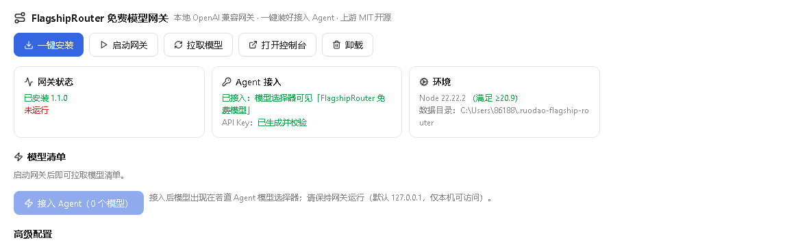

# 免费模型网关（把免费大模型接进你的 AI Agent）

> **免费模型的入口，不该是一个需要手动配环境的技术活。** FlagshipRouter 是社区里少见的「本地 OpenAI 兼容网关 + 控制台」，把一批免费模型聚合成一个标准 API。可惜原版要自己 clone、装依赖、build、起服务、建 Key、再手动填进 Agent——每一步都能劝退一半人。
>
> 若道免费模型网关把这一整条链路做成**一键插件**：装完点一次「一键安装」，插件自动下载源码、构建网关、启动进程、生成 API Key；勾选模型后一键接入若道 Agent，重启也还在。整个过程不用碰命令行，不用配环境变量，不用记 Key。

**📦 一键安装**：[https://ruodao.com/plugin-market/items/flagship-router](https://ruodao.com/plugin-market/items/flagship-router)（若道桌面端「功能插件市场」搜索"免费模型网关"，或市场页直接「下载 ZIP」用本地安装导入。）

---

## 💎 四个理由

### 🆓 1. 免费模型，直接变成 Agent 的模型

网关背后是一批免费额度模型。插件把网关的 `/v1/models` 与后台 catalog 的「就绪状态、上下文窗口」合并成一张模型清单，你在工作台里勾哪几个，哪几个就出现在若道 Agent 的模型下拉框里——**不需要复制 API 地址和 Key 到设置页手动填**。

### ⚙️ 2. 一键安装，2–8 分钟无人值守

下载源码 → `npm install` → `next build`，全程后台跑，**关掉界面也不中断**。进度以阶段 + 逐条日志的形式实时回传，失败了直接告诉你卡在哪一步。已装好的依赖会复用，重试不用再等一遍 `npm install`。

- 支持 GitHub 镜像加速（默认内置 `gh-proxy.com` 前缀，可改）；
- 支持**离线安装**：本地源码目录或 ZIP 直接装，不联网也能构建；
- 自动补齐 `better-sqlite3` / `@aws-sdk/credential-providers` 这两个在 `next build` 期间被静态解析的 optional 依赖，且跳过原生编译——**不需要 Visual Studio C++ 工具链**。

### 🔑 3. API Key 自动生成、自动校验

开启 `REQUIRE_API_KEY` 时，插件会自己登录控制台创建一把名为「Ruodao Agent」的 Key，并立刻验证有效性。Key 只落盘在 `~/.ruodao-flagship-router`，不进仓库、不进日志、不发给任何第三方。

### 🧯 4. 装坏了也能自己收拾

`doctor` 一条命令逐项体检：Node 版本、安装状态、网关连通性、Key 是否有效、模型数对不对，**不产生任何费用**。`log` 直接给安装日志和运行日志的末尾，排障不用翻目录。端口被占用会自动换空闲端口，网关和若道桌面端的数据目录完全隔离。

## 🖼️ 界面预览

| 网关工作台（状态 · 一键安装） | 模型清单与 Agent 接入 |
| --- | --- |
| [](docs/screenshots/1.png) | [](docs/screenshots/2.png) |

## ✨ 功能总览

| 能力 | 说明 |
| --- | --- |
| 📦 **一键安装** | 后台下载源码 → 安装依赖 → 构建网关（Next.js），2–8 分钟；支持本地源码/ZIP 与镜像加速 |
| 📊 **进度可查** | 轮询后台任务：当前阶段、逐条日志、成功或失败原因；状态持久化，重启后仍可查 |
| 🚀 **启动 / 停止** | 默认 `127.0.0.1:20128`，端口占用自动换空闲端口；停止不影响已构建产物与配置 |
| 🧩 **模型清单** | 合并 `/v1/models` 与后台 catalog 的就绪状态、上下文窗口；网关没起时自动拉起 |
| 🔌 **接入 Agent** | 勾选模型后注册为模型提供方（`wire_api = "responses"`），写入 `config.toml`，重启仍在 |
| 🩺 **环境自检** | Node 版本 / 安装 / 连通性 / Key / 模型数逐项检查，零费用 |
| 📜 **日志** | 安装日志与运行日志末尾内容，用于排障 |
| 🗑️ **卸载** | 停止并删除构建产物；`{ purge: true }` 连数据目录（含密钥、日志）一起删 |

## 📥 安装

1. 下载并安装 [若道桌面端](https://ruodao.com)。
2. 「功能插件市场」→ 搜索 **免费模型网关** → 安装；或从市场页下载 ZIP，用「插件管理 → 从本地安装」导入（不需登录）。
3. 打开侧边栏「免费模型网关」工作台，点 **一键安装**。
4. 安装完成后点 **启动网关**。

环境要求：Node.js ≥ 20.9（推荐 22 LTS），带 npm（没有时插件会自动下载 npm 运行时）。首次构建需要网络下载约 60–150 MB 源码与依赖。

## 🚀 使用教程

### 第一次接入（约 5 分钟，其中 2–8 分钟在构建）

1. **一键安装**：点下去就可以去干别的，进度卡片会显示「下载源码 → 安装依赖 → 构建」。
2. **启动网关**：构建完成后点「启动网关」，状态卡会显示端口、控制台地址与自动生成的密码。
3. **拉取模型**：点「拉取模型」，清单里每个模型都带就绪状态与上下文窗口。
4. **勾选 + 接入 Agent**：勾上要用的模型，点「接入 Agent」——打开若道 Agent 的模型下拉框就能看到它们。
5. **可选：进控制台配上游**：浏览器打开 `http://127.0.0.1:20128`，用状态卡里的密码登录，可以自己加上游账号、调模型映射。

### 构建失败怎么办

先点「查看日志」看最后 30 行。常见原因只有三类：

- **Node 版本过低**：`doctor` 会直接报出来，升到 20.9+ 再试；
- **网络下载失败**：在配置里把 `RUODAO_FLAGSHIP_MIRROR` 换成可用的镜像，或改用离线安装（`RUODAO_FLAGSHIP_SOURCE_ZIP` 指向本地 ZIP）；
- **端口被占**：插件会自动换端口，不用管。

## 🛠️ 二次开发：改代码，即时生效

插件免编译，源码即运行包：

```
├── plugin.json           # 元信息：名称、版本、UI 入口
├── ruodao-plugin.json    # 核心：id、权限（network/process）、9 个命令声明
├── ui.json               # 插件界面配置
├── bin/flagship-router.mjs  # 命令入口（install/status/start/models/doctor…）
├── lib/core.mjs          # 安装、进程、Key、模型清单的业务逻辑
├── test/plugin.test.mjs  # 测试
└── docs/screenshots/     # 本页截图
```

- 🤖 **让若道 Agent 帮你改（推荐）**：在桌面端直接说需求，比如"把默认端口改成 20129"、"模型清单按上下文窗口排序"，Agent 读源码、改代码、本地安装验证，即时生效。
- 👨‍💻 **自己改**：① 在 `lib/core.mjs` 改逻辑；② 在 `ruodao-plugin.json` 的 `contributes.commands` 注册/调整命令；③ 市场页「插件管理 → 从本地安装」选文件夹验证。开发期也可以直接改已安装目录 `~/.codex/plugins/codex-market/flagship-router/` 后重启应用。

运行测试：

```bash
node --test test/
```

**不要硬编码 API Key**。宿主提供模型凭据注入（`modelBinding`），走官方机制才安全。

## ⚙️ 配置项

| 变量 | 说明 |
| --- | --- |
| `RUODAO_FLAGSHIP_PORT` | 网关端口，默认 20128 |
| `RUODAO_FLAGSHIP_MIRROR` | GitHub 加速镜像前缀，如 `https://gh-proxy.com` |
| `RUODAO_FLAGSHIP_SOURCE_ZIP` | 离线安装：源码 ZIP 本地路径 |
| `RUODAO_FLAGSHIP_SOURCE_DIR` | 离线安装：本地源码目录 |
| `RUODAO_FLAGSHIP_API_KEY` | 手动指定网关 API Key（留空自动生成） |
| `RUODAO_FLAGSHIP_HOME` | 数据目录，默认 `~/.ruodao-flagship-router` |

## 📦 更新日志

- **v1.0.1**：模型清单合并后台 catalog 就绪状态与上下文窗口；接入 Agent 走 `/v1/responses`；构建失败复用已装依赖。
- **v1.0.0**：首次开源——一键安装、自动启动、自动 API Key、模型接入、自检与日志。

## 🔗 相关

- 插件市场页：[https://ruodao.com/plugin-market/items/flagship-router](https://ruodao.com/plugin-market/items/flagship-router)
- 上游项目：[FlagshipRouter](https://github.com/theRizwan/FlagshipRouter)（基于 9router，MIT）
- 若道官网：[https://ruodao.com](https://ruodao.com)
- 更多插件源码：[https://github.com/ruodaoai](https://github.com/ruodaoai)

## License

MIT。仅供学习研究，请遵守上游项目与各模型提供方的服务条款。
